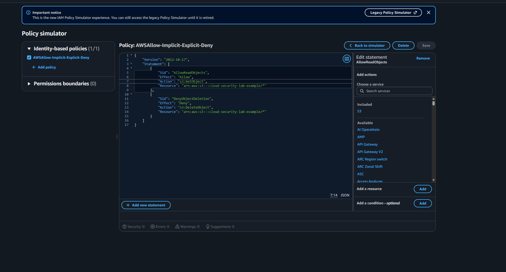
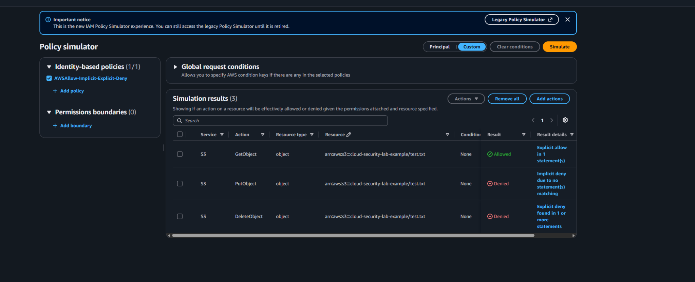

# AWS IAM Policy Evaluation: Allow, Implicit Deny, and Explicit Deny


**Project date:** September 21, 2026  
**Platform:** AWS IAM Policy Simulator  
**Security focus:** IAM authorization, least privilege, and policy evaluation

## Project overview

This project demonstrates how AWS evaluates identity-based policies when an action is explicitly allowed, not mentioned, or explicitly denied. I created a custom policy for a fictional Amazon S3 object and validated three authorization decisions without deploying an S3 bucket or incurring cloud charges.

## Objectives

- Permit read access with `s3:GetObject`.
- Leave `s3:PutObject` ungranted to demonstrate implicit denial.
- Block `s3:DeleteObject` with an explicit Deny.
- Verify each decision with the AWS IAM Policy Simulator.
- Apply least privilege by granting only the required read action.

## Policy design

The policy applies to objects under the fictional resource:

```text
arn:aws:s3:::cloud-security-lab-example/*
```

| S3 action | Policy treatment | Expected result |
|---|---|---|
| `GetObject` | Explicitly allowed | Allowed |
| `PutObject` | Not included | Implicit deny |
| `DeleteObject` | Explicitly denied | Explicit deny |

The complete policy is available in [`policies/s3-object-access-policy.json`](policies/s3-object-access-policy.json).

## Implementation

### 1. Create the custom policy

The Allow statement grants only `s3:GetObject`. A separate Deny statement blocks `s3:DeleteObject`.



### 2. Configure the simulation

I tested all three operations against this fictional object ARN:

```text
arn:aws:s3:::cloud-security-lab-example/test.txt
```

No actual bucket, object, IAM user, or deployed policy was required.

### 3. Validate the results



The simulator returned the expected decisions:

- **GetObject — Allowed:** an Allow statement matched the requested action and resource.
- **PutObject — Implicit deny:** no matching Allow statement granted the action.
- **DeleteObject — Explicit deny:** the Deny statement matched and took precedence.

## Security analysis

AWS starts with an implicit deny. Access becomes allowed only when a matching Allow applies and no applicable explicit Deny exists. An explicit Deny overrides an Allow, regardless of statement order.

This behavior supports least privilege: identities receive only the actions needed for their job, while destructive operations can be protected with explicit guardrails.

## Troubleshooting performed

The first simulation did not match the expected results because the S3 resource type was incomplete. I corrected each test by selecting the `object` resource type and using the same object ARN as the policy. I also removed `PutObject` from the Allow statement so it would correctly demonstrate implicit denial.

## Skills demonstrated

- AWS IAM policy structure and JSON syntax
- Allow, implicit-deny, and explicit-deny evaluation
- S3 object ARN scoping
- Least-privilege access design
- Policy testing and troubleshooting
- Security validation before deployment

## Cost and cleanup

This lab cost **$0**. It used a custom policy inside the simulator and did not create cloud resources. No infrastructure cleanup was necessary. The custom simulator policy may be deleted after the evidence is captured.

## Important limitation

The IAM Policy Simulator is a validation tool. Its output demonstrates policy logic, but it does not replace testing against an authorized non-production environment before a production rollout.

